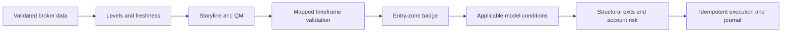

# V5 implementation specification and source audit

The user supplied v5 on 27 October 2026 PKT and instructed that it govern the strategy. The complete 25,927-byte document has been read and preserved unchanged in `sources/strategy-v5.md` (SHA-256 `a8fda60e940ace80aea1dfcef28c0960972a397d8bba4917666051ec577c93ff`). `COMPLIANCE_V5.md` and `requirements-v5.json` cover all 26 numbered subsections and 180 substantive source lines. This is an implementation specification and gap record, not a declaration that the existing v4 runtime already implements v5.

## Authority and reference boundary

- V5 governs new strategy work. Older source documents remain historical references.
- The uploaded `msnr_monitor.py`, `msnr_monitorr.py`, `msnr_discord.py` and `msnr_chart.py` are examples. They are not imported as project modules, executed, or treated as trading-rule authority.
- Earlier direct user clarifications resolve the A/V ambiguity: opposite-colour candles form A/V shapes, while same-colour candles form GAPs. This also matches v5 §3.3. The parenthetical alternative in §2.2 is inconsistent with that definition.
- Directly approved USDJPY/USDCHF comparison remains positive/direct; the broad “Positive / Inverse” table cell does not select an inverse algorithm.
- Existing non-conflicting v4 details as supplements, risk-phase precedence, and early ERS precedence were explicitly approved by the user and recorded in DECISIONS.md. The model-specific ERS exception and account-type risk ladder supersede conflicting general wording; missing mandatory evidence rejects a model.

## Rule dependencies and exact predicates

1. Validate instrument identity, timestamps, OHLC, tick/lot constraints and observation availability. Never use later candles to construct an earlier signal.
2. Construct A/V/GAP levels at the adjacent candle body junction; retain the wick apex separately. Evolve wick touches, third-candle CC repair, body-close breaks and flipped roles in timestamp order.
3. Build trendlines from qualifying shapes. Touches 1/2 establish the line, 3/4 can qualify, 5+ cannot qualify as continuation entries.
4. Identify the storyline source and opposing destination. Derive direction, source freshness and source touch time before looking for a QM. Advanced storylines require sufficient level history to substantiate exhaustion.
5. Detect the ordered QM swing structure and a directional body-close breakout. Wick sweeps alone are not breakouts. Apply the ERS exception under the explicit user-approved exception.
6. Apply v5’s specific level/validation-frame map: MN1/D1, W1/H4, D1/H1, H4/M15, H1/M5. Use the mapped validation-frame evidence; do not substitute a different higher-timeframe candle. Body-close requirements use closed candles.
7. Require an eligible badge at the entry zone: M15/M5 rejection or GAP/TL break; M5/M1 mini QM; or M5 EMA9 cross plus one additional closed holding candle. V5 does not impose an additional engulfing prerequisite on every break or EMA badge.
8. Apply model-specific geometry and confluences. Standard MSNR does not inherit universal session/Q3/CRT gates from an institutional overlay. QT and Circle models require SMT. Unknown peer evidence rejects SMT-required models.
9. Use New York local wall time with DST. V5 sessions are Asia 20:00–00:00, London 02:00–05:00 and NY 08:00–11:00. A 90-minute micro-cycle has four 22.5-minute quarters, with second-level boundaries. Earlier 90-minute quarters inside a six-hour cycle are not the v5 micro-cycle.
10. Use exactly the v5 Fibonacci ratios and 0.707–0.786 OTE interval. Confirmed swing anchors must exist before the entry observation. Ratio calculations alone do not constitute a complete Circle signal model. Prior v4 confirmed-QM anchor details can supplement only if their use is approved.
11. Set stops beyond the observed structural wick extreme plus the configured buffer in v5’s asset range. All three exits use 50/30/20 of original volume, with BE after confirmed TP1 fills. Broker tick and volume rounding must not violate the stop, target or risk rules.
12. Enforce every applicable required condition, configuration risk ceiling, account permission, reconciliation, spread/slippage limit, duplicate reservation and journal write before an order. Never use a rating to excuse failed mandatory evidence.

## Resolved precedence

The user approved v4 gap-filling, the separate evaluation/funded risk ladders, updated EX1–EX4 triggers, and early ERS as an exception to the main breakout requirement. See DECISIONS.md for exact predicates. There are no pending clarification questions from this audit.

## Remaining verification and implementation limits

The enabled v5 path now has a raw-candle LS rejection integration test (including the TP1 2–3R gate), exact timeframe/badge predicates, model-specific requirements, developing ERS structure support, and risk-boundary tests. This does not establish complete historical coverage for every named setup. All eight trendline classifications do not yet have independently labelled end-to-end fixtures. Complete-history attestation remains required for advanced storyline exhaustion.

QT's exact half-minute range boundary is unavailable from the present M1 feed. QT_SMT therefore fails its Q2 evidence gate instead of fabricating a range. A future tick/sub-minute ingestion path is required for that model. Circle OTE uses confirmed QM apex/breakout anchors with mandatory SMT; its complete real-market pipeline remains unverified. EX1 presently verifies the micro-QM alternative; an independent generic MSS detector is not claimed.

## Findings from the reference examples

The MT5 feed example attaches through the official `MetaTrader5.initialize()` API to the existing terminal, checks connection state, reconnects with `shutdown()`/`initialize()`, discovers broker symbols, and obtains native ticks/rates. Its refresh logic avoids recalculating structures when the candle timestamp has not changed. These are useful engineering patterns to assess against the current adapter.

The examples also contain ATR-based tolerances, optional synthetic feeds, fallback R targets, a legacy seven-hour bias, personal-account risk presets, and automatic loss-based blocking. Those are example-specific assumptions. They do not become v5 strategy requirements. No synthetic data may be displayed as live MT5 data, and historical losses may not silently rewrite entry eligibility.

## Validation required before claiming v5 compliance

- Test exact boundary values, including QT half-minute boundaries, DST/session transitions, each Fibonacci ratio, every risk threshold and 50/30/20 volume rounding.
- Test BUY and SELL interpretations, correct/incorrect rejection timeframe, missing peer data, optional versus mandatory SMT, and removal of undocumented global hybrid gates.
- Retain existing failure/restart/idempotency tests and prove older uncertain orders remain reconciled after a policy change.
- Add raw-candle positive/negative fixtures for every enabled model. Existing primitive or catalogue tests do not prove full historical model compliance.
- Verify the actual Windows terminal with the read-only native check, then verify complete required histories and controlled demo fills. Linux tests and Windows installer tests alone do not establish live feed or trading performance.

No new v5 strategy implementation preceded this audit. Unresolved definitions and incomplete real-market validation must remain visible in readiness records.

## Chrome/TradingView reference review

The provided `msnr_tv.py` uses Chrome CDP and `window.TradingViewApi.activeChart()` for native shapes. Its existence is session-dependent. The project now probes that capability and can annotate a recorded signal on an exact user-selected chart symbol/timeframe, read back native anchors, and verify invariance after zoom and pan. It never claims that TradingView prices equal broker prices. Timeframe switching remains unverified and drawings must be regenerated on the exact signal timeframe. Discord continues to use deterministic charts from actual broker OHLC. Reference strategy calculations, synthetic demo data, guessed time offsets, and fallback targets were not adopted.
